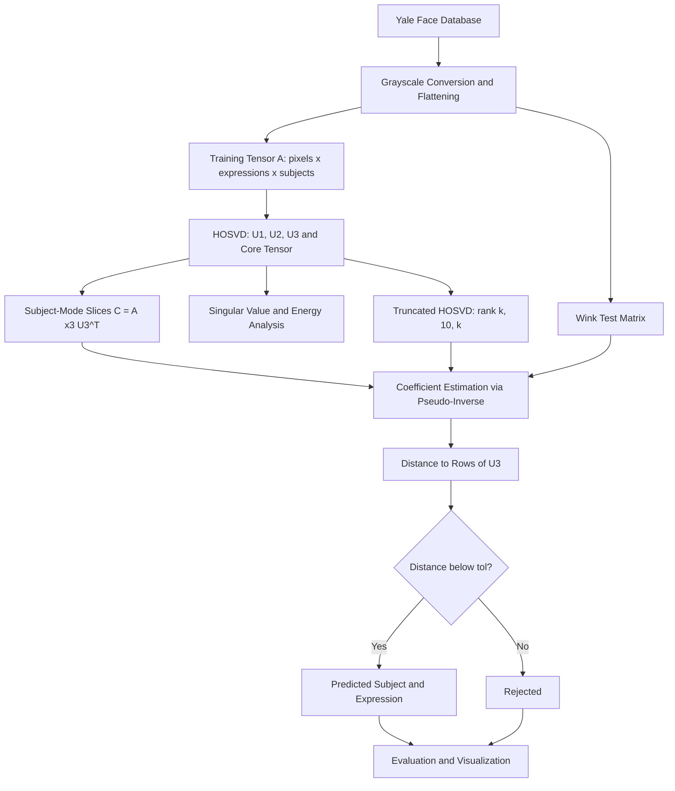

<div align="center">
  
</div>

---

# HOSVD-Based Face Recognition with Tensor Decomposition on the Yale Face Database

This project implements a tensor-based face recognition system using Higher-Order Singular Value Decomposition (HOSVD). Face images are organized into a third-order tensor of pixels, facial expressions, and subjects, and identity is recovered under an unseen facial expression through subject-mode coefficient estimation and a tolerance-based decision rule.

<div align="left">

[](https://www.python.org/)
[](https://numpy.org/)
[](https://pandas.pydata.org/)
[](https://matplotlib.org/)
[](https://python-pillow.org/)
[](https://jupyter.org/)
[](#)
[](#dataset)
[](#)
[](https://opensource.org/licenses/MIT)

</div>

## Abstract

Classical face recognition pipelines flatten images into vectors and discard the multilinear structure of the data, which naturally varies along independent factors such as identity and facial expression. This project models the Yale Face Database as a third-order tensor and applies HOSVD to obtain orthogonal bases for the pixel, expression, and subject modes. A held-out expression (`wink`) is used as the test set, and recognition is performed by estimating subject-mode coefficients for each expression slice and selecting the globally closest (expression, subject) pair. The project further studies a recognition-compatible rank-(k, 10, k) truncated HOSVD for k = 2, 5, 10 and analyzes how truncation rank and tolerance affect coverage and accuracy.

## Table of Contents

1. [Overview](#overview)
2. [Methodology](#methodology)
   - [Tensor Construction](#tensor-construction)
   - [HOSVD Recognition Algorithm](#hosvd-recognition-algorithm)
   - [Truncated HOSVD](#truncated-hosvd)
3. [Pipeline Architecture](#pipeline-architecture)
4. [Dataset](#dataset)
5. [Experimental Results](#experimental-results)
   - [Singular Value Analysis](#singular-value-analysis)
   - [Full HOSVD Recognition](#full-hosvd-recognition)
   - [Truncated HOSVD Recognition](#truncated-hosvd-recognition)
   - [Key Observations](#key-observations)
6. [Project Structure](#project-structure)
7. [Installation](#installation)
8. [Usage](#usage)
9. [License](#license)
10. [Author](#author)
11. [Support](#support)

---

# Overview

The project applies multilinear algebra to face recognition. Rather than treating every image as an independent vector, the full collection of training images is stored in a single tensor, and HOSVD is used to separate the factors of variation along each mode.

Core capabilities include:

* Construction of a pixel x expression x subject image tensor
* Full HOSVD with singular value analysis for all three modes
* Subject identification under an unseen facial expression
* Tolerance-based accept/reject decision rule (`tol = 0.1, 0.01, 0.001`)
* Rank-(k, 10, k) truncated HOSVD for `k = 2, 5, 10`
* Visual comparison of test faces and their matched training faces

---

# Methodology

## Tensor Construction

All training images are converted to grayscale and flattened into vectors of length `l = 77,760` (243 x 320 pixels). They are arranged in a tensor

$$\mathcal{A} \in \mathbb{R}^{l \times m \times n}, \quad l = 77760,\; m = 10,\; n = 15$$

where mode 1 is the pixel-vector mode, mode 2 is the facial-expression mode (10 training expressions), and mode 3 is the subject mode (15 subjects). The `wink` expression is excluded from the training tensor and used exclusively as the test set, so recognition is evaluated under an expression never seen during training.

## HOSVD Recognition Algorithm

HOSVD factorizes the tensor using the left singular vectors of each mode unfolding:

$$\mathcal{A} = \mathcal{S} \times_1 U_1 \times_2 U_2 \times_3 U_3$$

The recognition rule operates in the subject mode:

1. Compute $\mathcal{C} = \mathcal{A} \times_3 U_3^{T}$.
2. For each training expression slice $C_e$, estimate the subject-mode coefficient vector of a test image $z$ as $\alpha_e = C_e^{+} z$.
3. Compare $\alpha_e$ with every row of $U_3$ using the Euclidean distance.
4. Select the globally closest (expression, subject) pair across all expressions.
5. Accept the prediction only if the minimum distance is at most `tol`; otherwise the image is rejected.

## Truncated HOSVD

To keep the expression index identifiable by the recognition rule, the truncated variant compresses only the image and subject modes:

* Mode 1 (image): first `k` components
* Mode 2 (expression): all 10 components retained
* Mode 3 (subject): first `k` components

The resulting representation has multilinear rank (k, 10, k). Test images are projected with $U_{1,k}^{T}$ before the same coefficient-estimation and distance-based decision rule is applied.

---

# Pipeline Architecture



---

# Dataset

The project uses the **Yale Face Database**, which contains 165 grayscale GIF images of 15 subjects, with 11 images per subject covering the following conditions: `centerlight`, `glasses`, `happy`, `leftlight`, `noglasses`, `normal`, `rightlight`, `sad`, `sleepy`, `surprised`, and `wink`.

| Property | Value |
| :-------- | :----- |
| Subjects | 15 |
| Images per subject | 11 |
| Training expressions | 10 (all except `wink`) |
| Test set | 15 `wink` images |
| Image size | 243 x 320 (77,760 pixels) |

The dataset is used for research purposes, in accordance with its original terms.

---

# Experimental Results

## Singular Value Analysis

Cumulative energy captured by the first `k` singular values of each mode unfolding:

| Mode | k = 2 | k = 5 | k = 10 |
| :---- | :----- | :----- | :------ |
| Mode 1 (image) | 93.51% | 96.02% | 97.55% |
| Mode 2 (expression) | 97.30% | 99.03% | 100% |
| Mode 3 (subject) | 94.27% | 96.83% | 98.85% |

The first singular value dominates in all three modes. Since images are not mean-centered, it mainly encodes the average face and overall brightness rather than identity.

## Full HOSVD Recognition

| tol | Accepted | Coverage | Accuracy (accepted) |
| :--- | :-------- | :-------- | :------------------- |
| 0.1 | 2 / 15 | 13.3% | 100% |
| 0.01 | 0 / 15 | 0% | - |
| 0.001 | 0 / 15 | 0% | - |

## Truncated HOSVD Recognition

| k | tol | Accepted | Correct | Mean Distance |
| :- | :--- | :-------- | :------- | :------------- |
| 2 | 0.1 | 15 | 6 (40%) | 0.0157 |
| 2 | 0.01 | 9 | 4 (44.4%) | 0.0157 |
| 2 | 0.001 | 0 | 0 | 0.0157 |
| 5 | 0.1 | 1 | 1 (100%) | 0.375 |
| 5 | 0.01 / 0.001 | 0 | 0 | 0.375 |
| 10 | 0.1 | 2 | 2 (100%) | 0.675 |
| 10 | 0.01 / 0.001 | 0 | 0 | 0.675 |

## Key Observations

* **Tolerance is only a rejection threshold.** The computed distances do not change with `tol`; the smallest observed distance is about 0.06, so `tol = 0.01` and `0.001` accept nothing.
* **Precision versus coverage.** Full HOSVD at `tol = 0.1` is highly precise but rarely commits to a decision, which is expected for an expression never seen during training.
* **Distances are not comparable across ranks.** Rows of the truncated subject factor shrink in norm as `k` decreases, so a fixed tolerance is loose at `k = 2` and strict at `k = 10`. High coverage at small `k` reflects weak subject separation rather than better recognition.
* **Cumulative energy is a poor guide for choosing k**, because the uncentered first component saturates the energy while carrying little identity information.
* The test set contains only 15 images, so small differences between configurations are not statistically meaningful.

---

# Project Structure

```text
HOSVD_Face_Recognition
│
├── HOSVD_Face_Recognition.ipynb
│
├── data/
│   ├── train/
│   ├── test/
│   └── Readme.txt
│
└── README.md
```

---

# Installation

## Clone Repository

```bash
git clone https://github.com/ParmidaGh/HOSVD_Face_Recognition.git

cd HOSVD_Face_Recognition
```

## Create Environment

```bash
conda create -n hosvd-face python=3.10

conda activate hosvd-face
```

## Install Dependencies

```bash
pip install numpy pandas matplotlib pillow jupyter
```

---

# Usage

Launch Jupyter and open the notebook:

```bash
jupyter notebook HOSVD_Face_Recognition.ipynb
```

The first code cell locates and extracts the Yale Face archive. Update the `candidate_archives` list in that cell to point to your local copy of the dataset, then run all cells in order to build the tensor, compute the HOSVD, evaluate recognition on the `wink` test set, and reproduce the truncated HOSVD comparison.

---

# License

This project is licensed under the MIT License.

---

## Author

**Parmida Ghamari**
M.Sc. Student, University of Tehran
Research Assistant @ Social Networks Lab

**Research Interests:** Tensor Decomposition, Higher-Order SVD (HOSVD), Face Recognition, Numerical Linear Algebra, Dimensionality Reduction, Computer Vision, Machine Learning

📧 [Parmida.ghamari@gmail.com](mailto:Parmida.ghamari@gmail.com) | 💻 [github.com/ParmidaGh](https://github.com/ParmidaGh) | 💼 [linkedin.com/in/parmida-ghamari](https://www.linkedin.com/in/parmida-ghamari)

---

# Support

If you find this project useful, consider giving it a star ⭐️

---

<p align="center">
  Built with NumPy, pandas, Matplotlib, and the Yale Face Database
</p>
